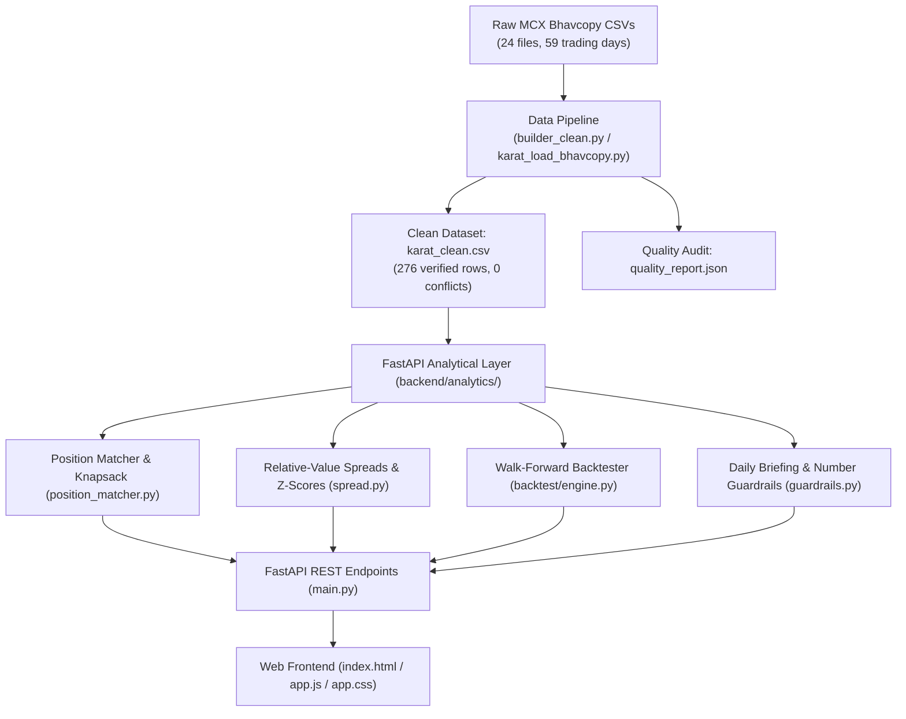

# KARAT — System Architecture & Feature Reference Guide

**Karat** is a quantitative commodity derivatives intelligence prototype engineered specifically for **MCX Gold Futures**. It transforms raw exchange settlement data (MCX Bhavcopy) into actionable, expiry-aware relative-value intelligence, eliminating the structural pricing distortions that misinform retail bullion traders.

---

## 1. Core Problem & The Normalisation Solution

### The Market Distortion
On the Multi Commodity Exchange of India (MCX), gold futures trade across four distinct contracts:
* **GOLDM (Gold Mini)**: 100 g lot, quoted per 10 g, **995 purity** (delivers 0.4% less pure gold per gram), expires on the **5th of the month**.
* **GOLDTEN**: 10 g lot, quoted per 10 g, **999 purity**, expires on the **last calendar day**.
* **GOLDGUINEA**: 8 g coin lot, quoted per 8 g, **999 purity**, expires on the **last calendar day**.
* **GOLDPETAL**: 1 g micro lot, quoted per 1 g, **999 purity**, expires on the **last calendar day**.

Because quote bases, pack sizes, purities, and expiry dates differ, **raw screen prices cannot be compared directly**. A trader who compares GOLDM (₹1,44,696/10g) with GOLDTEN (₹1,45,062/10g) directly misses that GOLDM delivers 995 gold and expires 5–6 days later (carrying extra financing cost).

### The Mathematical Normalisation
Karat converts all contract prices onto a single, standardized benchmark: **₹ per gram of 999 fine gold**:

$$\text{Normalised Price (₹/g)} = \left(\frac{\text{Raw Settlement Close}}{\text{Quote Base (g)}}\right) \times \left(\frac{999}{\text{Purity}}\right)$$

* **GOLDTEN**: $\frac{P}{10} \times \frac{999}{999} = \frac{P}{10}$ (Direct benchmark)
* **GOLDM**: $\frac{P}{10} \times \frac{999}{995}$ (Accounts for 995 fineness)
* **GOLDGUINEA**: $\frac{P}{8} \times \frac{999}{999} = \frac{P}{8}$
* **GOLDPETAL**: $\frac{P}{1} \times \frac{999}{999} = P$

---

## 2. System Architecture

* **Calculation Layer**: Strictly decoupled in Python (`backend/analytics/`). Zero business logic or financial calculations occur in frontend templates or AI prompts.
* **Data Guarantee**: 59 active trading sessions (03 Aug 2026 to 23 Oct 2026, 60 weekdays). Reconciled the 1 missing session as **Mahatma Gandhi Jayanti (02 Oct 2026)**, an official exchange statutory holiday.
* **Deterministic Deduplication**: Identified by `(date, symbol, expiry_date)`. Evaluated against 0 price conflicts.

---

## 3. Comprehensive Feature Guide

### Feature 1: 3D Luxury Landing Stage & Spotlight Mask Reveal
* **Purpose**: Creates an immediate visual impression while maintaining an institutional dark-mode aesthetic.
* **What it does**: 
  - Renders an interactive WebGL 3D dynamic fluid-tube simulation reacting to mouse velocity and touch.
  - Clicking **"Experience KARAT"** triggers an animated radial clipping mask expanding from the cursor coordinates, revealing the analytics suite without page reloads.

### Feature 2: Plain-English Opportunity Answer Card
* **Purpose**: Answers the executive question: *"Is there a statistically significant trading opportunity right now?"*
* **What it does**:
  - Scans active spread z-scores across all 6 contract pairs.
  - Compares the observed gap against real-world transaction friction (exchange turnover fees, STT, brokerage, and bid-ask slippage).
  - Displays a clean green/amber status card with the cheap and rich contracts, alongside an expandable plain-English explanation of why the spread exists.

### Feature 3: Unified Normalisation Scale & 3D Bullion Pack Bars
* **Purpose**: Eliminates visual misinterpretation of lot sizes and purities.
* **What it does**:
  - Renders authentic 3D SVG gold bullion bars stamped with fineness (`995` vs `999`), contract symbols, and lot weights.
  - Height scaling follows physical cube-root volume ($H \propto \sqrt[3]{\text{Grams}}$) so a 100g bar physically looks larger than a 1g petal.
  - Includes a **"Level Scale"** toggle button that animates all bars to equal height for direct ₹/g price comparison.
  - Clicking a bar highlights its corresponding row in the Unified Normalisation Table.

### Feature 4: Contract Chooser & Position Matcher
* **Purpose**: Physical bullion hedgers and jewelers need to hedge specific gold weights (e.g., 100g) using futures without being over- or under-hedged.
* **What it does**:
  - **Inputs**: User inputs quantity in grams (defaults to `100g`, with `10g`, `100g`, `1,000g` one-click presets) and selects an expiry cycle (auto-defaults to nearest active cycle with $>3$ days left).
  - **Single-Contract Cards**: Shows lots needed (`floor(Q / lot_size)`), grams covered, leftover grams badge (`Exact match` when 0), total contract value in ₹, normalized cost per gram, and premium vs benchmark `GOLDTEN` in basis points.
  - **GOLDM Carry Note**: Dynamically identifies when GOLDM expires after the other three (5th vs 30th/31st) and displays: *"GOLDM expires on [date], [N] days after GOLDTEN — price includes [N] extra days of carry."*
  - **Expandable 999-Equivalent Fineness Row**: Details physical benchmark purity delivery (e.g. `GOLDM 995 delivers 99.6g fine gold per 100g contract weight`).
  - **Knapsack Combination Solver**: Computes the top 3 exact multi-contract combinations that hit target grams with the fewest total lots.
  - **Best-Fit Ranking**: Automatically tags the best allocation based on: (1) exact match first, (2) lowest basis-point premium, (3) highest turnover. Includes caveat warnings for small premium differences ($<10\text{ bps}$) or short lookbacks.

### Feature 5: Spread Lab (Relative-Value Dislocation Engine)
* **Purpose**: Quantifies historical basis-point dislocations between pairs.
* **What it does**:
  - Allows traders to select any of the 6 contract pairs (e.g., `GOLDM vs GOLDTEN`, `GOLDTEN vs GOLDPETAL`).
  - Calculates rolling spread z-scores with **strict no-lookahead bias** (shifted rolling window: day $t$ uses strictly data prior to $t$).
  - Adapts sample window dynamically: standard 20-day window when history $\ge 40$ days; 10-day window if $<40$ days.
  - Plots historical spread in ₹/g and basis points against upper/lower statistical entry bands ($\pm 1.5\sigma$ or $\pm 2.0\sigma$).

### Feature 6: Walk-Forward Backtester & Trade Execution Log
* **Purpose**: Simulates whether a mean-reverting statistical arbitrage strategy would have been profitable after real trading friction.
* **What it does**:
  - **Out-of-Sample Separation**: Prevents overfitting by strictly separating tuning data from unseen test data.
  - **Friction Modeling**: Deducts round-trip brokerage, exchange turnover charges, stamp duty, and execution slippage ($1.5\times$ spread).
  - **Performance Analytics**: Computes Net PnL (₹), Win Rate (%), Profit Factor, Maximum Drawdown (%), and Sharpe Ratio.
  - **Completed Round-Trip Execution Log**: Detailed table of every simulated trade: Entry Date, Exit Date, Long/Short Legs, Holding Days, Gross Spread PnL, Total Friction Cost, and Net Realized PnL.

### Feature 7: Contract Lifecycle & Delivery Tender Calendar
* **Purpose**: Prevents accidental physical delivery penalties on MCX.
* **What it does**:
  - Highlights the **Tender Period** (last 5 trading days prior to expiry) where margin requirements jump and delivery obligations initiate.
  - Flags near-expiry contracts with amber badges ($\le 3$ days remaining) and provides roll-window timing recommendations to roll front-month positions into the next active month.

### Feature 8: Data Quality Audit & Data & Method Tab
* **Purpose**: Transparent institutional compliance.
* **What it does**:
  - Summarizes the complete ingestion audit: files discovered, files accepted, rows loaded, duplicate resolutions, and price conflict logs (0 conflicts).
  - Exchange holiday reconciliation explicitly verifying that missing weekdays were scheduled statutory holidays.
  - Direct CSV export downloads for Clean Bhavcopy, Trade Execution Logs, and Historical Spread Signals.

### Feature 9: AI Guide with Strict Numbers Guardrails
* **Purpose**: Answers user questions contextually without introducing financial hallucinations.
* **What it does**:
  - Provides panel-specific **"Explain this"** deep dives for every chart and table.
  - **Cryptographic-Grade Numeric Guardrail**: Every AI output is passed through `validate_ai_output()` in `guardrails.py`. If the AI generates any number, percentage, or currency figure not present in the supplied panel JSON payload, the output is discarded and replaced with a verified prewritten explanation.
  - Every explanation explicitly starts with *"What this does not tell you: "* to ensure traders recognize the analytical boundary.
  - Permanent compliance badge on all analytical views: *"Informational only · Not investment advice"*.

---

## 4. Contract Specifications Matrix

| Specification | GOLDM (Gold Mini) | GOLDTEN | GOLDGUINEA | GOLDPETAL |
| :--- | :---: | :---: | :---: | :---: |
| **MCX Symbol** | `GOLDM` | `GOLDTEN` | `GOLDGUINEA` | `GOLDPETAL` |
| **Trading Unit (Lot Size)** | 100 grams | 10 grams | 8 grams | 1 gram |
| **Price Quote Base** | per 10 grams | per 10 grams | per 8 grams | per 1 gram |
| **Purity Fineness** | **995 / 1000** | **999 / 1000** | **999 / 1000** | **999 / 1000** |
| **Expiry Day** | 5th of expiry month | Last calendar day | Last calendar day | Last calendar day |
| **Tender Period** | 5 days before expiry | 5 days before expiry | 5 days before expiry | 5 days before expiry |
| **Delivery Unit** | 1 kg bar or 100g | 100g bar / 10g bar | 8g coin | 1g coin |
| **Benchmark Role** | Main retail/hedger volume | Unified Benchmark | Coin premium retail | Micro physical bullion |

---

## 5. Verification & Testing Standards

The prototype enforces **110 automated pytest tests** covering:
* Contract normalisation and rounding precision.
* Knapsack combination logic and best-fit ranking.
* Strict separation of in-sample tuning vs out-of-sample backtest evaluation.
* Zero lookahead bias in rolling mean and standard deviation.
* Deterministic deduplication across raw CSV batches.
* Rejection of hallucinated numbers in AI responses.
