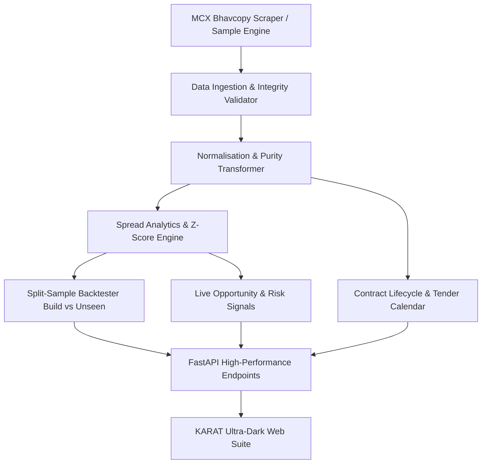

# KARAT
### MCX Gold Futures Cross-Contract Relative-Value Intelligence & Backtesting Engine

[](https://karat-commodity-t6ym.onrender.com)
[](backend/tests)
[](https://python.org)
[](https://karat-commodity-t6ym.onrender.com/docs)
[](https://karat-commodity-t6ym.onrender.com)

---

## Official Live Deployment
- **Live Web Application:** [https://karat-commodity-t6ym.onrender.com](https://karat-commodity-t6ym.onrender.com)

---

## Prototype Overview & Core Features

KARAT is an institutional-grade quantitative commodity intelligence and relative-value analytics prototype engineered for Multi Commodity Exchange of India (MCX) Gold Futures. The platform resolves the structural fragmentation across MCX's four gold contracts—GOLDM (100g, 995 fineness), GOLDTEN (10g, 999 fineness), GOLDGUINEA (8g, 999 fineness), and GOLDPETAL (1g, 999 fineness)—by converting raw price quotes into a unified benchmark of Indian Rupees per gram of 999 pure gold.

The platform delivers six core integrated modules:
1. Purity Normalisation & Contract Chooser: Standardises heterogeneous purities and quote lot multipliers, pairing an interactive position matcher that solves target gold allocations with minimum cash drag.
2. Statistical Spread Lab: Computes zero-lookahead 20-day rolling Z-scores, historical basis spreads, multi-expiry term structure curves, and annualized carry costs.
3. Walk-Forward Backtest Engine: Simulates mean-reversion pairs trading subject to a realistic 4-leg transaction friction barrier (10.0 bps hurdle), liquidity slippage penalties, and strict 60/40 In-Sample versus Out-of-Sample validation.
4. Market Replay Studio: Features an interactive 60-FPS animated graph visualizer rendering continuous particle waveforms, interactive scrubbing, and dynamic Phase-Space Mean-Reversion Orbit diagrams around an equilibrium attractor.
5. Real-Time 4-Gate Opportunity Radar: Evaluates simultaneous normalisation, liquidity, transaction cost hurdles, and statistical thresholds before signaling trades.
6. Regulatory Lifecycle & Audit Pipeline: Enforces MCX 5-day physical tender window roll guards and exports clean bhavcopy datasets, trade ledgers, and JSON quality verification reports.

---

## Local Development Quickstart

### 1. Start the Unified Application (Backend + Frontend)
```bash
python -m uvicorn backend.api.main:app --host 0.0.0.0 --port 8000
```
- Local App & API Docs available at `http://localhost:8000` and `http://localhost:8000/docs`.

### 2. Run the Quantitative Test Suite
```bash
python -m pytest
```
> **132 unit, integration, and statistical invariant tests** verify no-lookahead bias, cost monotonicity, contract lifecycle guards, and normalisation mathematical precision.

---

## Mathematical Framework & Normalisation

MCX lists four distinct gold futures contracts:

| Symbol | Quote Unit | Purity | Lot Multiplier | Normalisation Formula |
| :--- | :--- | :---: | :---: | :--- |
| **GOLDM** (Mini) | ₹ / 10g | 995 | 100g | `(Price / 10) * (999 / 995) ≈ Price * 0.100402` |
| **GOLDTEN** (10g) | ₹ / 10g | 999 | 10g | `Price / 10` |
| **GOLDGUINEA** | ₹ / 8g | 999 | 8g | `Price / 8` |
| **GOLDPETAL** | ₹ / 1g | 999 | 1g | `Price / 1.0` |

### Inter-Contract Spread Calculation
$$\text{Spread}_{A,B} = P_{\text{norm},A} - P_{\text{norm},B} \quad (\text{₹/gram})$$
$$\text{Spread (bps)} = \frac{\text{Spread}_{A,B}}{\frac{1}{2}(P_{\text{norm},A} + P_{\text{norm},B})} \times 10{,}000$$

### Rolling Z-Score & Statistical Arbitrage
$$Z_t = \frac{\text{Spread}_t - \mu_{20}(t)}{\sigma_{20}(t)}$$
- **Entry Rule:** $|Z_t| \ge 2.0$ (mean-reversion statistical dislocation)
- **Exit Rule:** $|Z_t| \le 0.5$ or **Time Stop** ($> 15$ trading days)
- **4-Leg Cost Model:** Every round-trip trade requires 2 opening fills + 2 closing fills (4 legs total), with an exchange turnover / brokerage / slippage tax applied per leg.
- **Thin-Liquidity Penalty:** Days with $< 50$ volume contracts face a 2.0× penalty multiplier on slippage.

---

## System Architecture



---

## Key Modules & Endpoints

| Endpoint | Description |
| :--- | :--- |
| `GET /health` | System status, active data source (`sample` or `mcx`), supported contracts |
| `GET /contracts` | Live normalised price per gram, purity factor, 24h change, sparkline data |
| `GET /spread?pair=GOLDM_GOLDTEN` | Historical spread series, rolling z-score, upper/lower bounds |
| `GET /curve?symbol=GOLDM` | Term structure, annualized forward carry cost across expiries |
| `GET /signal` | Active statistical dislocation alerts and liquidity risk flags |
| `GET /backtest?period=unseen` | Walk-forward split-sample backtest with strict holdout lock |
| `GET /calendar` | MCX tender periods, roll windows, listing dates, and expiry countdowns |
| `GET /quality` | Bhavcopy data audit report (zero volume, price outliers, duplicates) |
| `GET /export/trades.csv` | Full trade-by-trade ledger CSV download |
| `GET /export/spreads.csv` | Historical pair spreads dataset download |
| `GET /export/normalised.csv` | Comprehensive normalised prices dataset download |
| `GET /export/clean.csv` | Clean validated MCX Bhavcopy time-series dataset CSV |
| `GET /export/quality.json` | Reproducible data pipeline validation and quality audit report JSON |

---
