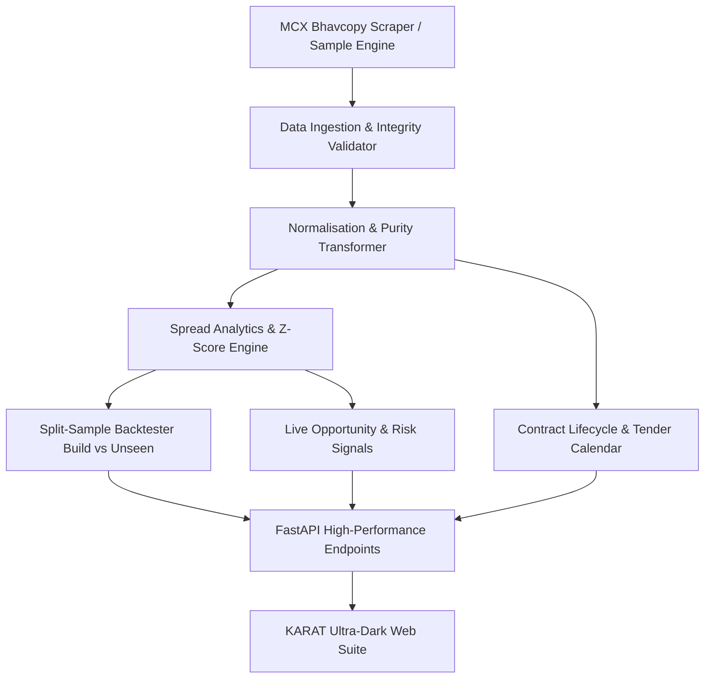

# KARAT
### MCX Gold Futures Cross-Contract Relative-Value Intelligence & Backtesting Engine

[](https://karat-commodity-t6ym.onrender.com)
[](backend/tests)
[](https://python.org)
[](https://karat-commodity-t6ym.onrender.com/docs)
[](https://karat-commodity-t6ym.onrender.com)

---

## Official Live Deployment
- **Live Web Application:** [https://karat-commodity-t6ym.onrender.com](https://karat-commodity-t6ym.onrender.com)

---

**KARAT** solves the fundamental structural challenge in trading MCX gold futures: **the four primary contracts (GOLDM, GOLDTEN, GOLDGUINEA, GOLDPETAL) trade at different unit sizes, contract purities (995 vs 999), and lot bases.** 

KARAT mathematically standardises every contract to **₹ per 1 gram of 999 fineness gold**, calculates real-time calendar and cross-contract basis spreads, flags thin-liquidity regimes, enforces strict exchange physical delivery/tender period constraints, and delivers a leak-free walk-forward backtesting engine with split-sample discipline.

---

## Local Development Quickstart

### 1. Start the Unified Application (Backend + Frontend)
```bash
python -m uvicorn backend.api.main:app --host 0.0.0.0 --port 8000
```
- Local App & API Docs available at `http://localhost:8000` and `http://localhost:8000/docs`.

### 2. Run the Quantitative Test Suite
```bash
python -m pytest
```
> **132 unit, integration, and statistical invariant tests** verify no-lookahead bias, cost monotonicity, contract lifecycle guards, and normalisation mathematical precision.


---

## Mathematical Framework & Normalisation

MCX lists four distinct gold futures contracts:

| Symbol | Quote Unit | Purity | Lot Multiplier | Normalisation Formula |
| :--- | :--- | :---: | :---: | :--- |
| **GOLDM** (Mini) | ₹ / 10g | 995 | 100g | `(Price / 10) * (999 / 995) ≈ Price * 0.100402` |
| **GOLDTEN** (10g) | ₹ / 10g | 999 | 10g | `Price / 10` |
| **GOLDGUINEA** | ₹ / 8g | 999 | 8g | `Price / 8` |
| **GOLDPETAL** | ₹ / 1g | 999 | 1g | `Price / 1.0` |

### Inter-Contract Spread Calculation
$$\text{Spread}_{A,B} = P_{\text{norm},A} - P_{\text{norm},B} \quad (\text{₹/gram})$$
$$\text{Spread (bps)} = \frac{\text{Spread}_{A,B}}{\frac{1}{2}(P_{\text{norm},A} + P_{\text{norm},B})} \times 10{,}000$$

### Rolling Z-Score & Statistical Arbitrage
$$Z_t = \frac{\text{Spread}_t - \mu_{20}(t)}{\sigma_{20}(t)}$$
- **Entry Rule:** $|Z_t| \ge 2.0$ (mean-reversion statistical dislocation)
- **Exit Rule:** $|Z_t| \le 0.5$ or **Time Stop** ($> 15$ trading days)
- **4-Leg Cost Model:** Every round-trip trade requires 2 opening fills + 2 closing fills (4 legs total), with an exchange turnover / brokerage / slippage tax applied per leg.
- **Thin-Liquidity Penalty:** Days with $< 50$ volume contracts face a 2.0× penalty multiplier on slippage.

---

##  System Architecture



---

##  Key Modules & Endpoints

| Endpoint | Description |
| :--- | :--- |
| `GET /health` | System status, active data source (`sample` or `mcx`), supported contracts |
| `GET /contracts` | Live normalised price per gram, purity factor, 24h change, sparkline data |
| `GET /spread?pair=GOLDM_GOLDTEN` | Historical spread series, rolling z-score, upper/lower bounds |
| `GET /curve?symbol=GOLDM` | Term structure, annualized forward carry cost across expiries |
| `GET /signal` | Active statistical dislocation alerts and liquidity risk flags |
| `GET /backtest?period=unseen` | Walk-forward split-sample backtest with strict holdout lock |
| `GET /calendar` | MCX tender periods, roll windows, listing dates, and expiry countdowns |
| `GET /quality` | Bhavcopy data audit report (zero volume, price outliers, duplicates) |
| `GET /export/trades.csv` | Full trade-by-trade ledger CSV download |
| `GET /export/spreads.csv` | Historical pair spreads dataset download |
| `GET /export/normalised.csv` | Comprehensive normalised prices dataset download |

---
