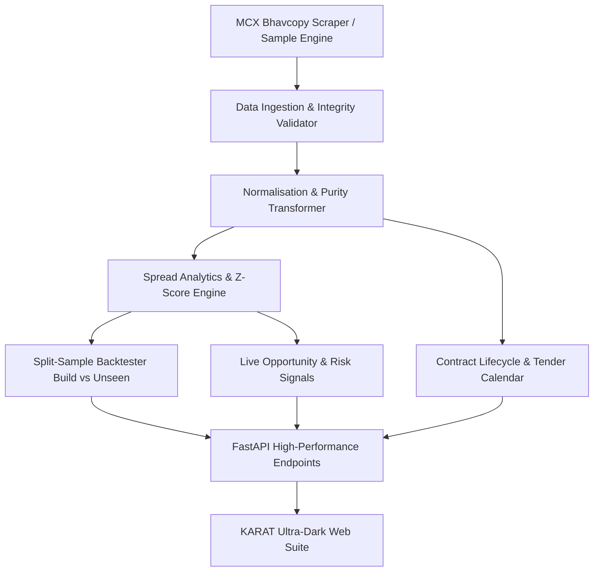

# KARAT 🏆
### MCX Gold Futures Cross-Contract Relative-Value Intelligence & Backtesting Engine

[](backend/tests)
[](https://python.org)
[](http://127.0.0.1:8000/docs)
[](index.html)

**KARAT** solves the fundamental structural challenge in trading MCX gold futures: **the four primary contracts (GOLDM, GOLDTEN, GOLDGUINEA, GOLDPETAL) trade at different unit sizes, contract purities (995 vs 999), and lot bases.** 

KARAT mathematically standardises every contract to **₹ per 1 gram of 999 fineness gold**, calculates real-time calendar and cross-contract basis spreads, flags thin-liquidity regimes, enforces strict exchange physical delivery/tender period constraints, and delivers a leak-free walk-forward backtesting engine with split-sample discipline.

---

## ⚡ Quickstart

### 1. Start the FastAPI Analytics Engine
```bash
python -m uvicorn backend.api.main:app --host 127.0.0.1 --port 8000
```
- Interactive Swagger UI: [http://127.0.0.1:8000/docs](http://127.0.0.1:8000/docs)
- API Health Status: [http://127.0.0.1:8000/health](http://127.0.0.1:8000/health)

### 2. Launch the Frontend Application
```bash
python -m http.server 8080
```
- Open [http://127.0.0.1:8080](http://127.0.0.1:8080) in your browser.

### 3. Run the Quantitative Test Suite
```bash
python -m pytest
```
> **60 unit, integration, and statistical invariant tests** verify no-lookahead bias, cost monotonicity, contract lifecycle guards, and normalisation mathematical precision.

---

## 📐 Mathematical Framework & Normalisation

MCX lists four distinct gold futures contracts:

| Symbol | Quote Unit | Purity | Lot Multiplier | Normalisation Formula |
| :--- | :--- | :---: | :---: | :--- |
| **GOLDM** (Mini) | ₹ / 10g | 995 | 100g | `(Price / 10) * (999 / 995) ≈ Price * 0.100402` |
| **GOLDTEN** (10g) | ₹ / 10g | 999 | 10g | `Price / 10` |
| **GOLDGUINEA** | ₹ / 8g | 999 | 8g | `Price / 8` |
| **GOLDPETAL** | ₹ / 1g | 999 | 1g | `Price / 1.0` |

### Inter-Contract Spread Calculation
$$\text{Spread}_{A,B} = P_{\text{norm},A} - P_{\text{norm},B} \quad (\text{₹/gram})$$
$$\text{Spread (bps)} = \frac{\text{Spread}_{A,B}}{\frac{1}{2}(P_{\text{norm},A} + P_{\text{norm},B})} \times 10{,}000$$

### Rolling Z-Score & Statistical Arbitrage
$$Z_t = \frac{\text{Spread}_t - \mu_{20}(t)}{\sigma_{20}(t)}$$
- **Entry Rule:** $|Z_t| \ge 2.0$ (mean-reversion statistical dislocation)
- **Exit Rule:** $|Z_t| \le 0.5$ or **Time Stop** ($> 15$ trading days)
- **4-Leg Cost Model:** Every round-trip trade requires 2 opening fills + 2 closing fills (4 legs total), with an exchange turnover / brokerage / slippage tax applied per leg.
- **Thin-Liquidity Penalty:** Days with $< 50$ volume contracts face a 2.0× penalty multiplier on slippage.

---

## 🏛️ System Architecture



---

## 🚀 Key Modules & Endpoints

| Endpoint | Description |
| :--- | :--- |
| `GET /health` | System status, active data source (`sample` or `mcx`), supported contracts |
| `GET /contracts` | Live normalised price per gram, purity factor, 24h change, sparkline data |
| `GET /spread?pair=GOLDM_GOLDTEN` | Historical spread series, rolling z-score, upper/lower bounds |
| `GET /curve?symbol=GOLDM` | Term structure, annualized forward carry cost across expiries |
| `GET /signal` | Active statistical dislocation alerts and liquidity risk flags |
| `GET /backtest?period=unseen` | Walk-forward split-sample backtest with strict holdout lock |
| `GET /calendar` | MCX tender periods, roll windows, listing dates, and expiry countdowns |
| `GET /quality` | Bhavcopy data audit report (zero volume, price outliers, duplicates) |
| `GET /export/trades.csv` | Full trade-by-trade ledger CSV download |
| `GET /export/spreads.csv` | Historical pair spreads dataset download |
| `GET /export/normalised.csv` | Comprehensive normalised prices dataset download |

---

## 🎯 2-Minute Pitch & Demonstration Script

1. **The Hook (0:00 - 0:25)**:
   > *"Trading MCX Gold Futures isn't apples-to-apples. GOLDM is quoted in ₹/10g at 995 fineness, whereas GOLDTEN is 999 fineness. Many retail and algorithmic desks trade artificial spreads without adjusting for the 40-basis-point purity gap and contract multipliers. Meet **KARAT**."*

2. **The Solution (0:25 - 0:50)**:
   > *"KARAT ingests raw daily Bhavcopy, normalises every single contract into pure ₹/g of 999 fine gold, and computes real-time basis spreads. In the Overview screen, you can see all 4 contracts instantly unified side-by-side with 7-day sparklines."*

3. **Spread Lab & Real-Time Intelligence (0:50 - 1:15)**:
   > *"In our **Spread Lab**, traders can select any pair—like GOLDM vs GOLDTEN. KARAT plots the raw spread, carry-adjusted spread, and rolling 20-day $\pm 2\sigma$ Z-score bands, automatically detecting mean-reverting statistical arbitrage opportunities."*

4. **Institutional-Grade Backtesting & Risk Discipline (1:15 - 1:45)**:
   > *"Unlike naive backtesters that overfit on future data, KARAT enforces strict **Split-Sample Validation**: headline metrics are computed strictly on the **Unseen Holdout Period**. We account for 4 transaction legs per trade, apply double slippage on thin-volume contracts, and auto-liquidate positions before MCX physical delivery tender periods."*

5. **Closing (1:45 - 2:00)**:
   > *"KARAT delivers transparency, institutional rigor, and pure alpha for the Indian gold derivatives market. Built with FastAPI, tested with 60 rigorous invariants, and wrapped in a bespoke dark terminal interface."*
